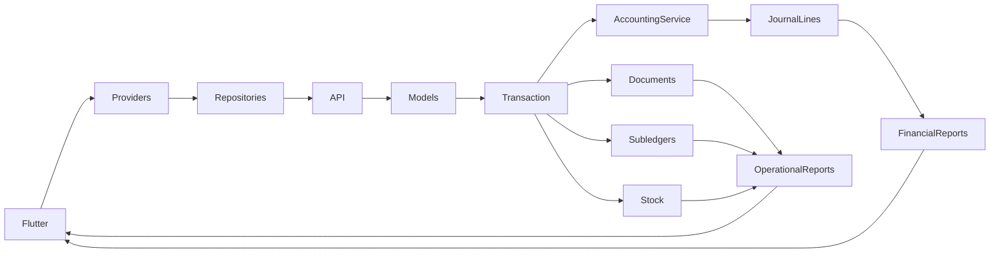

# Accounting architecture and truth model

Status: draft; detailed source inventory and executed reconciliations are being integrated.

The client is Flutter/Riverpod with Dio repositories; server routes/controllers delegate to models and specialized services over better-sqlite3. Journal lines are the financial GL; journal headers retain grouping and lineage. Operational document balances, party ledgers, allocations, stock balances, stock batches, and movements are separate representations that need reconciliation rather than mutual agreement alone.

Editable map: [accounting-flow.mmd](accounting-flow.mmd).

## Accounting dependency map

The account codes below were read from the fresh migrated database's chart and checked against posting-service references. Account `1110` is named Customer Credit and has debit-normal asset classification in this implementation; credit obligations therefore appear as signed balances there. That classification is described, not silently changed.

| Economic dimension | Modules that can change it | Operational representation | GL / reporting dependency |
|---|---|---|---|
| Cash and bank | Receipts, supplier/expense/salary payments, refunds, capital/drawings, employee loans, transfers, reconciliation | payments, linked document/payment records, cash counts | 1000 cash, 1010 bank, 1020–1040 wallets; cashService and cash-flow reports |
| Customer receivables | Invoices, returns, payments, offsets, unapplied-cash applications, reversals | invoices, customer_ledger, payment allocations | 1100 AR and 1110 customer credit; aging and customer statements |
| Supplier payables | Direct purchases, GRNs, bills, payments, returns, credit applications/refunds, reversals | purchases/receipts/bills, supplier_ledger and allocations | 2000 AP; supplier ledger and aging |
| Inventory quantity | Receipt/purchase, sale, return, production, adjustment, count, transfer, damage/write-off, goods withdrawal | stock_balances, stock_batches, stock_movements; item mirror | 1200 inventory, valuation/movement reports; quantity must reconcile independently of GL |
| Inventory valuation | All valued inventory events; FIFO/FEFO batch selection and joint-production allocation | remaining batch quantities × recorded unit cost, legacy exceptions | 1200; COGS, gross profit and balance sheet |
| Revenue and returns | Invoices, return documents, restocking fees, document reversals | invoice/return line amounts, discounts/taxes | 4000 sales, 4100 returns, 4150 restocking fees; P&L/dashboard/sales reports |
| Purchases and returns | Receipt recognition, direct purchase, supplier return, tax reversal | purchase/GRN/return line quantities, costs and taxes | 1200 inventory, 1320 input tax, 2000 AP/cash; purchase reports |
| COGS | Sales, customer returns and financial reversal | consumed original batch costs and reversal linkage | 5000 COGS; P&L and profit reports |
| Expenses and losses | Operating expenses/bills, salary, loan write-off, stock shrinkage/damage/expiry/shortage/obsolescence | expenses, salary and write-off documents | 6000 expenses, 6100 salary, 6300 loan loss, 7100 correction, 7200–7204 losses |
| Customer credit and deposits | Returns/settlements, allocations, unapplied receipts, cash refunds and reversals | source credits and consumption, customer_ledger, unapplied records | 1110 customer credit, 2110 unapplied customer payments; no new cash on allocation |
| Supplier credit and advances | Purchase returns, supplier payments/credit applications, prepayments/refunds | supplier_ledger, supplier credits, prepayments and allocations | 2000 AP and 1330 supplier prepayments; no new cash on credit application |
| Owner equity | Capital, cash/goods drawings, prior retained earnings and current income | capital/withdrawal documents | 3000 opening equity, 3100 retained earnings, 3200 capital, 3300 drawings; balance sheet |
| Payroll and liabilities | Salary expense/advance, employee loan disbursement/repayment/write-off, accrued overhead/expenses | salary payments/history, employee loans/repayments, expense payments | 1300 loans, 1310 salary advances, 2115 expense payables, 2200 accrued production overhead, 6100 salary |
| Production costs | BOM material consumption, output quantities, overhead, joint-output cost split, deletion/reversal | productions, production_inputs, production_outputs, resulting stock batches | 1200 inventory, 7000 production clearing, 2200 overhead payable or cash |
| Financial statements | Every above posting and period/void filter | active dated journal lines plus operational reconciliation | P&L, balance sheet, trial balance, GL, cash flow; assets = liabilities + equity including income |

Owner personal lending is separately implemented memorandum functionality; its treatment as outside business GL is a policy/model distinction, not an assumption that those routes do not exist. See the backend workstream for source details and unexecuted paths.

Source anchors: `lib/main.dart`; `server/src/app.ts`; `server/src/services/InvoiceCreationService.ts`; `server/src/services/accountingService.ts:308-425`; `server/src/__tests__/helpers/accountingInvariants.ts`. Existing authority maps in `server/docs/gl-authority-map.md` and `server/docs/stock-authority-map.md` are contextual design records; their older line references and unresolved observations are rechecked against current code.

## Recognition rules being tested

- A sale posts receivable and sales/tax, and separate stock relief/COGS. Cash receipts and credit allocations have different accounting legs.
- A PO is a commitment; actual goods receipt recognizes inventory and supplier payable under the application's implemented receipt-accrual model.
- A customer return reverses sales/receivable or creates credit; a cash refund is a separate event. A supplier return removes inventory and reduces payable or creates supplier credit.
- Stock quantities derive from location balances and reconcile to batches and movements. Batch costs drive valuation and COGS; item totals are mirrors.
- Damage/write-off must reduce inventory and recognize a loss once. Transfers should preserve company-wide quantity and cost.
- Owner contributions/drawings affect equity; employee loans/advances are assets until settled or expensed under the documented model. Production converts materials plus attributable overhead into output inventory.

The economic oracle does not call MiniERP calculation functions to derive expected results. Monetary comparisons use integer paise; SQL/report values are converted to minor units for comparison.

Inventory loss recognition and attributable production cost are cross-checked against the IFRS Foundation's [IAS 2 overview](https://www.ifrs.org/issued-standards/list-of-standards/ias-2-inventories/). This is an accounting-control benchmark, not an assertion that every business using MiniERP is required to report under IFRS.

## Known documentation discrepancy to resolve

`audit/DECISIONS.md` D12 describes historical current-stock allocation behavior. The fresh API oracle already rejects a sale dated before its receipt. This older description is not treated as a current defect; the final report will follow executed current behavior.
