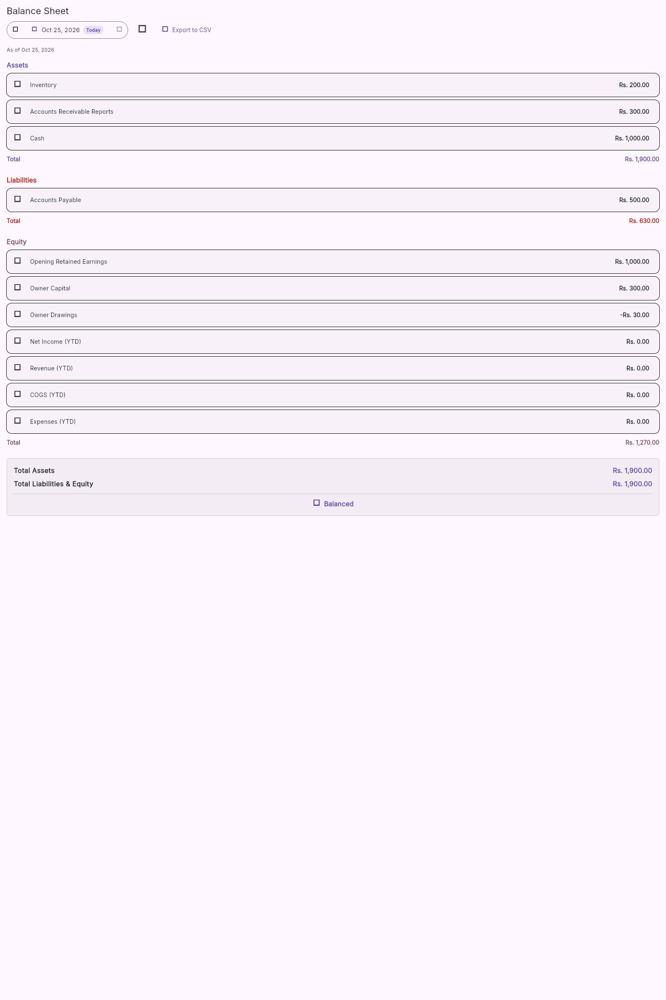

# Financial figure verification

Figures below are compared to independent economic events or explicitly identified synthetic API fixtures. Equality between two MiniERP surfaces alone is not the oracle.

Full discovery registers: [candidate surfaces](evidence/flutter-surfaces.csv), [4,529 candidate figure/numeric expressions](evidence/flutter-figures.csv), [support/data/formatting lines](evidence/flutter-support.csv), [report source/formula/provider mapping](workstreams/flutter-reports.md). These are conservative inventories across 431 Dart files and 223 candidate surfaces, **not 4,529 verified figures**. Unexecuted entries remain NOT TESTED, with source expression, context, provider/repository/endpoint candidates, refresh and rounding information. Candidate dependency sets are not proven per-expression data flow.

## Executed expected → database/API → Flutter comparisons

All amounts are Rs unless a quantity/count is specified. Retail figures use the combined September–October checkpoint described in [reconciliations](04-reconciliation-results.md). Actual API envelopes were replayed through production Dart models and mounted report widgets. That is stronger than static review but remains distinct from running the native desktop against the API.

| Screen / report | Figure | Expected | Actual | Difference | Status |
|---|---|---|---|---|---|
| P&L API/model/widget | Net revenue | 210 | 210 | 0 | PASS bounded retail fixture |
| P&L API/model/widget | Net COGS | 140 | 140 | 0 | PASS |
| P&L API/widget | Gross profit | 70 | 70 | 0 | PASS |
| P&L API/widget | Total expense | 20 | 20 | 0 | PASS total |
| P&L API/model/widget | Net profit | 50 | 50 | 0 | PASS |
| P&L API/widget expense breakdown | Detailed expense rows | 20 = operating10 + damage10 | 10, operating only | −10 | FAIL F-043; net profit remains correct |
| Balance sheet API/model/widget | Cash | 10,170 | 10,170 | 0 | PASS |
| Balance sheet API/model/widget | Inventory | 550 | 550 | 0 | PASS |
| Balance sheet API/model/widget | AR | 30 | 30 | 0 | PASS |
| Balance sheet API/model/widget | AP | 700 | 700 | 0 | PASS |
| Balance sheet API/model/widget | Equity | 10,050 | 10,050 | 0 | PASS |
| Balance sheet API/widget | Assets = liabilities + equity | 10,750 = 700 + 10,050 | Equal | 0 | PASS for retail fixture |
| Trial balance API/Dart model | Total debits | 11,490 | 11,490 | 0 | PASS model replay, grid interaction not executed |
| Trial balance API/Dart model | Total credits | 11,490 | 11,490 | 0 | PASS model replay |
| Cash flow API/Dart model | Net flow from zero opening incl capital | 10,170 | 10,170 | 0 | PASS model replay; complete method/transfer matrix untested |
| AR aging API/Dart model | Outstanding | 30 | 30 | 0 | PASS model replay; bucket cutoffs untested |
| AP aging API/Dart model | Outstanding | 700 | 700 | 0 | PASS model replay; bucket cutoffs untested |
| Stock valuation API/Dart model | Quantity | 55 units | 55 | 0 | PASS model replay |
| Stock valuation API/Dart model | Value | 550 | 550 | 0 | PASS model replay; valuation screen has no discovered route |
| Balance sheet synthetic nonzero-category widget | Other assets | 400 visible | Omitted | −400 visible detail | FAIL F-040 |
| Same widget | Tax payable | 60 visible | Omitted | −60 visible detail | FAIL F-040 |
| Same widget | Other liabilities | 70 visible | Omitted | −70 visible detail | FAIL F-040 |
| Same widget | Displayed asset components vs total | Components sum1,900 | Components1,500, total1,900 | −400 detail | FAIL F-040 |
| Same widget | Displayed liability components vs total | Components sum630 | Components500, total630 | −130 detail | FAIL F-040 |
| Balance-sheet actual CSV export | Cells in cash row | 3 | 4 | +1 column | FAIL F-041; valid CSV parser used |
| Salary pay dialog | Remaining after carryover already included in total_paid | 800 | 600 | −200 | FAIL F-042 |
| Salary fixture P&L API | Two settled periods' salary expense | 2,000 | 1,800 | −200 | FAIL F-020 source posting |
| Salary fixture balance-sheet API | Remaining advance asset | 0 | 200 | +200 | FAIL F-020 source posting |
| Early-return P&L API, 9 September | Revenue before purchase/sale | 0 | −15 | −15 | FAIL F-001 |
| Early-return P&L API, 9 September | COGS before purchase/sale | 0 | −10 | −10 | FAIL F-001 |
| Credit reuse DB vs economic obligation | Receivable after retained goods225 less cash150 | 75 | Customer/invoice receivable15; signed GL75 | −60 in operational receivable | FAIL F-002; GL reflects correct economic obligation |
| Production cost/GL | Inventory from Rs0.02 inputs | 0.02 | GL0.03 | +0.01 | FAIL F-022 |

Evidence: [Dart model replay](evidence/flutter-oracle-models.json), [mounted P&L](evidence/flutter-oracle-pnl-widget.json), [mounted balance sheet](evidence/flutter-oracle-balance-widget.json), [nonzero-category text](evidence/flutter-balance-sheet-widget.json), [salary dialog](evidence/flutter-salary-carryover-widget.json), [loss breakdown](evidence/flutter-pnl-breakdown.json), and each finding folder.

The image is an actual mounted test widget capture, not a live-business screenshot. It shows asset detail of 200 + 300 + 1,000 while total is 1,900; liability detail500 while total630; and a Balanced badge. Test icon glyph boxes are a harness/font limitation and are not reported as product defects.

## Report/display families with remaining verification gaps

| Report / display family | Source/formula established | Numerical/interaction status |
|---|---|---|
| Dashboard sales/purchase/AR/AP/profit/cash/inventory KPIs, trends/comparisons | API/GL/operational mappings inventoried; filters and boot/module refresh paths inspected selectively | PARTIAL; no full dashboard widget or every period/trend assertion |
| General ledger account lines/opening/running balances | Active dated journal_lines and SQL window mapped | PARTIAL; opening carry-in and every export/filter not independently executed |
| Customer/supplier ledgers/statements | Subledger records, allocations and derived summaries mapped | PARTIAL; critical credit failure proven, complete grouping/date/pagination coverage absent |
| Sales/purchase/returns summaries/by-item/by-party | Operational records, void/date/group filters mapped | PARTIAL; selected API captures do not verify every displayed subtotal or quantity label |
| AR summary/DSO/top debtors | API buckets and credit-sales/receivables metrics mapped | PARTIAL static/model; independent DSO methodology and zero-sales cases NOT TESTED |
| Inventory movement/low stock/batch traceability/expiry/item aging | Quantity/batch-cost/movement sources mapped | PARTIAL; no complete UI drilldown; item-aging has no established Flutter consumer |
| Production/BOM usage/costing reports | Production inputs/outputs/overhead sources mapped | PARTIAL; negative allocation reproduced; all report grouping/overhead combinations NOT TESTED |
| Expense reports/owner-equity reports/payment history/payroll prints | Posted and operational sources mapped | PARTIAL; selected defects verified; full print/export/period matrix NOT TESTED |
| Tax summary | Output/input-tax account mapping established | PARTIAL; receipt rounding sample passes; filing/remittance and all tax UI cases NOT TESTED |
| Custom reports | Query engine/entities/expression validation mapped | PARTIAL static; custom templates and independent numerical validation NOT TESTED; no consuming custom-report Flutter page established |
| Forecasts/demand/trends/accuracy | Planning API/model/formatting dependencies inventoried | NOT TESTED numerically; not certified accounting balances |
| All other dialogs/cards/details/PDFs/thermal print/shared CSV/statement exports | Each candidate source/line catalogued in CSV inventory | NOT TESTED unless a named executed check above/workstream overrides it |

The Reports hub has 16 routed report entries in the Flutter inventory; backend report routes are a larger set. An unrouted widget or unused endpoint constant is not executed UI coverage. No full-route, print-layout, all-filter or whole-application certification is made.
